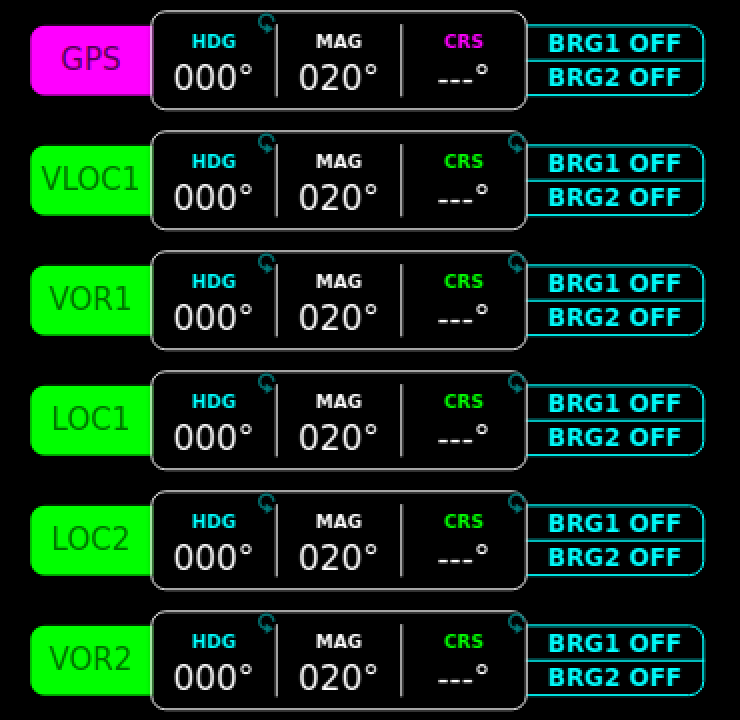

# AER-5029: NAVTYPE on the Beelink glass

The pyEfis HSI source tab on the Beelink bench, read from the gateway's
`NAVTYPE` key. fix-gateway was staged at `e97cf6c` (this PR) and pyEfis was on
`dev` at `b49a01e7`, unchanged. Taken 2026-11-14 18:39 UTC.



`source_tab_strip.png` shows the tab, cropped from the full 1920x1080 frames
(x 460-830, y 640-700) and scaled 2x nearest-neighbour. Top to bottom:

| Step | Written over netfix | Bus read back (value, flags) | Tab |
|---|---|---|---|
| gps | NAVSRC=2 | NAVTYPE 0.0 | GPS |
| nav1_unknown | NAVSRC=0, NAV1TYPE=0 | NAVTYPE 0.0 | VLOC1 |
| nav1_vor | NAV1TYPE=1 | NAVTYPE 1.0 | VOR1 |
| nav1_loc | NAV1TYPE=2 | NAVTYPE 2.0 | LOC1 |
| nav2_loc | NAV2TYPE=2, NAVSRC=1 | NAVTYPE 2.0 | LOC2 |
| nav2_vor | NAV2TYPE=1 | NAVTYPE 1.0 | VOR2 |

`beelink_nav1_loc_full.png` is the whole screen for the `nav1_loc` step. The
tapes are flagged and the attitude panel is blank because the bench had no
data source: X-Plane was not running. The blank attitude panel is pyEfis#360,
left by the deploy script's SIGUSR1 grab. A pyEfis restart afterwards
cleared it.

What this proves: the shipped database keys, the compute `NAVSRC` select and
pyEfis's label, end to end on the real bench. What it does not prove: the
X-Plane code map (`nav_type` 3/4/5 to 1/2), because NAV1TYPE/NAV2TYPE were
written by hand. That path is covered by `tests/plugins/xplane/test_xplane_navtype.py`
and by the in-server run in the PR body.

## Reproduce

```sh
S=makerplane/processes/paperclip/scripts/bench-deploy.sh   # maos-workspace
ssh -i $KEY pyefis@10.110.10.241 'sh -s' < $S -- --ref fix-gateway=aer-5029/navtype --owner AVIONICS --issue AER-5029
ssh -i $KEY pyefis@10.110.10.241 'flock -w 900 /tmp/pyefis-bench.lock sh -s' < drive.sh
ssh -i $KEY pyefis@10.110.10.241 'sh -s' < $S -- --restore=fix-gateway --owner AVIONICS --issue AER-5029
```

The frames land in `~/bench-scratch/aer5029/` on the bench. The strip is built with:

```python
from PIL import Image
names = ['gps', 'nav1_unknown', 'nav1_vor', 'nav1_loc', 'nav2_loc', 'nav2_vor']
crops = [Image.open(f'{n}.png').crop((460, 640, 830, 700)) for n in names]
w, h = crops[0].size
out = Image.new('RGB', (w * 2, h * 2 * len(crops)), 'black')
for i, c in enumerate(crops):
    out.paste(c.resize((w * 2, h * 2), Image.NEAREST), (0, i * h * 2))
out.save('source_tab_strip.png')
```
