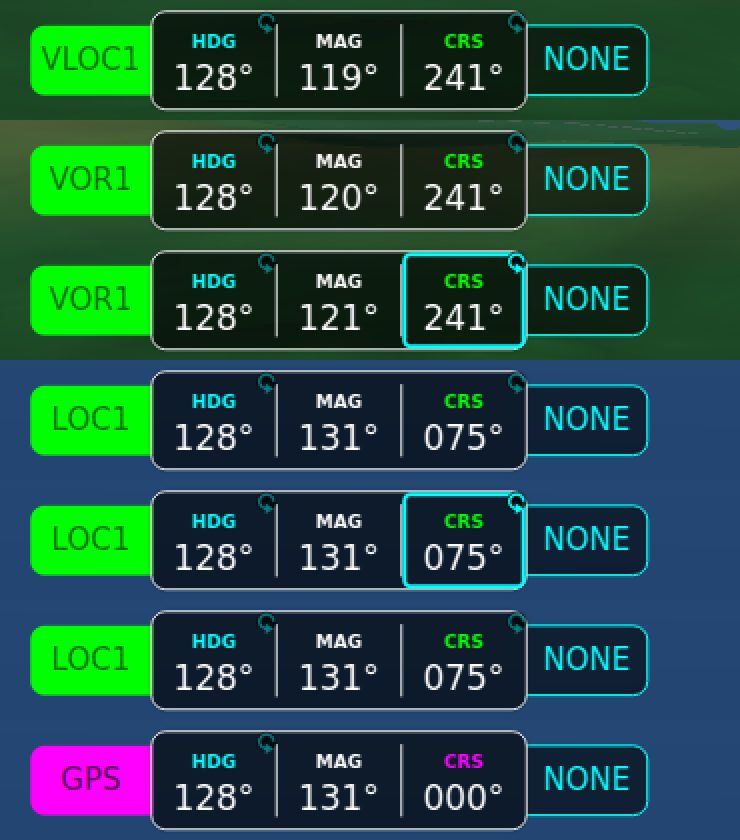

# AER-5658: X-Plane drives NAVTYPE onto the Beelink glass

The follow-up to `../aer-5029-navtype/`. There, NAV1TYPE and NAV2TYPE were
written by hand over netfix. Here X-Plane writes them. The sim-bench driver
flew session `709c94bc7d19` (profile `profile.yaml`, run
`20261118T140657Z-aer5658-navtype-gvo-golet`, outcome `complete`, 856 s)
while `drive.py` retuned NAV1 by DREF and grabbed the glass. The bench was
running fix-gateway `04f8d59` (dev, includes #178) and pyEfis `dev`.
The frames were taken on 2026-11-18 between 14:08 and 14:14 UTC.



`source_tab_strip.png` is the HSI source tab and readouts, cropped from the
1920x1080 frames (x 460-830, y 640-700) and scaled 2x nearest-neighbour.
Each row is the second of two grabs. Top to bottom:

| Step | X-Plane `nav_type[0]` | Bus NAV1TYPE / NAVTYPE | Tab | CRS |
|---|---|---|---|---|
| NAVSRC=0, NAV1 108.70 (nothing) | 0 | 0 / 0 | VLOC1 | 241 |
| NAV1 114.90 (RZS), 21.5 nm | 3 | 1 / 1 | VOR1 | 241 |
| tap CRS, push (VOR control) | 3 | 1 / 1 | VOR1, CRS focused | 241 |
| NAV1 110.30 (ISBA), steady 8 s, 11.7 nm | 4 | 2 / 2 | LOC1 | 075 |
| tap CRS | 4 | 2 / 2 | LOC1, CRS focused | 075 |
| push on the localizer | 4 | 2 / 2 | LOC1, edit ended | 075 |
| NAV1 back to 108.70, NAVSRC back to 2 | 0 | 0 / 0 | GPS | 000 |

`beelink_nav1_loc_full.png` is the whole screen at the LOC1 step.

## CRS push

NAV1CRS is X-Plane's `nav1_obs_degm` at 10 Hz, so a value read afterwards
proves nothing. `drive.py` subscribes to NAV1CRS and lists every change in
the 3.3 s after the encoder push (BTN3 over netfix, after an xdotool tap on
the CRS readout at 691,672):

- **VOR (control):** 91 updates, values {241.0, 95.0}. The push wrote
  95.0, the station bearing (VOR1BRG 94.5), and X-Plane put back 241 about
  0.03 s later.
- **Localizer:** 92 updates, all 75.0. The push wrote nothing and ended
  the edit, as pyEfis `tests/instruments/hsi/test_hsi_touch_edit.py`
  specifies. NAVTYPE was 2 immediately before and after the push.

The full lists are in `drive.log` (`CRS PUSH` lines).

## Bus against X-Plane

`bus_vs_xplane.csv` holds 2 Hz rows of X-Plane's raw `nav_type[0]`, NAV1
frequency, OBS, HSI source and display-horizontal flag, read on `drive.py`'s
own RREF socket, independent of fixgw, beside the bus keys.

- Of 706 rows with both sides live, 705 match the {3:1, 4:2, 5:2} map
  (others to 0).
- The one mismatch is at 14:13:42.0, the row where NAV1 was retuned away.
  There the bus already read 0 while this socket still read 4. One row later
  both read 0. That is sampling skew between the two subscriptions, not a
  mapping error.

X-Plane reported **13** (standalone DME) whenever 110.30 was tuned outside
the localizer's coverage. It heard the ILS DME without the localizer, and
the map turned the unlisted code into 0, so the tab showed VLOC1. The
localizer was briefly received at 14:10:54 (about 16 nm, near the edge of
coverage), then lost. `drive.py` therefore waits for 8 s of steady
reception before the LOC steps.

## How the bench was set up

`session.sh` is the sim_follow hook. It adds the NAV1TYPE/NAV2TYPE rows to
the Beelink's hand-edited `xplane.yaml`; they stay, as the shipped
behaviour. For the session only, it also comments out the `XPHSISRC`
`dataref_writes` row. Otherwise NAVSRC=0 would switch X-Plane's HSI source to
NAV1 and pull the pilotless driver's autopilot off GPS. The end hook restores
the row and restarts fixgw.

## Reproduce

Submit `profile.yaml` with `sim-session.sh submit profile.yaml <ISSUE>`. Then
arm `sim_follow.py --sid <id> --on-start "sh session.sh start" --on-end "sh
session.sh stop"` on the Beelink, from a directory holding `drive.py` and
`session.sh`. The strip is built with:

```python
from PIL import Image
names = ['nav1_default_2', 'nav1_vor_2', 'vor_crs_push_2', 'nav1_loc_2',
         'loc_crs_focus_2', 'loc_crs_push_2', 'restored_2']
crops = [Image.open(f'{n}.png').crop((460, 640, 830, 700)) for n in names]
w, h = crops[0].size
out = Image.new('RGB', (w * 2, h * 2 * len(crops)))
for i, c in enumerate(crops):
    out.paste(c.resize((w * 2, h * 2), Image.NEAREST), (0, i * h * 2))
out.save('source_tab_strip.png')
```
