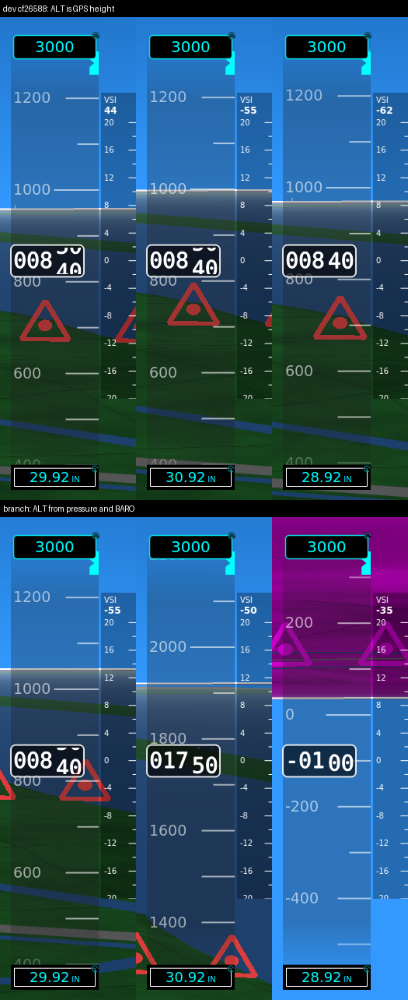

# MAVALT1: the altimeter follows the baro knob on a mavlink panel (AER-6351)

ArduPlane 4.7.2 SITL (its own flight model, no X-Plane) under the real
`mavlink` plugin, `ahrs` and `pressure` on, in the real fixgw server with
`compute` on. `tools/mavlink_sitl/baro_session.py` turns `BARO` over netfix
and logs `ALT`, `TALT`, `PALT` and `AIRPRESS` 3 s after each setting
(sandbox runs: 1.5 s). Then the head presses NAV, and the `DO_REPOSITION`
altitude the plugin sent is read from its own tlog. `pascal_offset` is 0
(SITL's barometer needs no correction).



`tape_strip.png`: the altimeter tape from the Beelink glass in cruise, 1:1
crops of 1920x1080 x11grab frames. Top row dev, bottom row the branch; BARO
29.92, 30.92, 28.92 from left to right. On dev the tape reads 840 at all three
settings. On the branch it reads 843, 1752, -101. The magenta SVS at 28.92 is
a pyEfis matter: the SVS camera height reads `ALT` (see the PR).

## Beelink (10.110.10.241), cruise, about 255 m above KSBA

| BARO | dev `ALT` | dev `TALT` | branch `ALT` | branch `TALT` | branch `PALT` |
|---|---|---|---|---|---|
| 29.92 | 844.09 | 844.09 | 843.20 | 844.39 | 844.37 |
| 30.92 | 843.18 | 843.18 | 1751.75 | 840.29 | 840.33 |
| 28.92 | 839.93 | 839.93 | -100.78 | 837.73 | 838.02 |

The `DO_REPOSITION` sent at NAV, with BARO at 30.92: dev 838.7 ft, which is
`ALT` and `TALT` (equal on dev). The branch sent 835.8 ft, which is `TALT`,
not the 1746.8 ft `ALT`. The autopilot held it: `TALT` 833.3 ft 20 s later.

On the ground on the Beelink, the branch's `ALT` reads 9.0, 922.0 and
-928.8 ft at 29.92, 30.92 and 28.92 (the sandbox agrees within 0.5 ft).
`TALT` stays between 10.5 and 10.6, and `PALT` between 10.0 and 10.6 (KSBA
is 3 m, 9.8 ft). Dev's `ALT` reads 10.6 at all three settings, and dev's
`PALT` swings from 11.8 to -900.8 to 949.4, because `compute` reads the
GPS height as an indicated altitude. The ground frames show pyEfis's
navigation-data boot screen (it leaves for the PFD once the aircraft moves),
so only the cruise frames are in the strip.

**The before capture reproduced the defect,** on the Beelink and in the
sandbox: `ALT` equal to `TALT` at every setting.

## Files

- `beelink/<side>/session.log`: each sample with flags (`/aobfs`), the
  reposition, and `prov.txt` (fix-gateway and pyEfis SHAs). Dev is `cf26588`,
  the branch `874a8b6` (its code is unchanged since then), and pyEfis is
  the bench's `62b18366`.
- `beelink/<side>/png/cruise-<BARO>.png`: the full frames the strip is cut
  from.
- `sandbox/<side>/session.log`: the same session in the agent sandbox, with
  no display.

## Regenerate

Sandbox (see `tools/mavlink_sitl/README.md` for the binary and deps):

```sh
cd tools/mavlink_sitl
PYTHONPATH=deps python3 baro_session.py <dev tree> out-dev
PYTHONPATH=deps python3 baro_session.py ../.. out-fix
```

Beelink, an isolated stack beside the live services (they keep running).
`~/bench-scratch/aer6351/` holds `sitl/` (`arduplane`, `plane.parm`,
`bridge.py`, `baro_session.py`), `fgw-dev` and `fgw-fix` (shared clones of
`~/src/fix-gateway` at each SHA), and `pcfg`, a copy of
`~/makerplane/pyefis/config` with `FixPort: 3492`.

```sh
# start_pyefis.sh <log>
DISPLAY=:0 QT_QPA_PLATFORM=xcb setsid -f ~/pyefis-venv/bin/pyefis \
  --config-file ~/bench-scratch/aer6351/pcfg/default.yaml >"$1" 2>&1 </dev/null

# run.sh <dev|fix>, under the bench lock
S=~/bench-scratch/aer6351; L=$1; cd $S/sitl
export BARO_NETFIX_PORT=3492 BARO_SETTLE=3
export BARO_ON_SERVER="$S/start_pyefis.sh $S/out/$L/pyefis.out; sleep 15"
export BARO_ON_SAMPLE="DISPLAY=:0 ffmpeg -loglevel error -y -f x11grab -draw_mouse 0 -i :0.0 -frames:v 1 $S/out/$L/png/\$1.png"
~/pyefis-venv/bin/python baro_session.py $S/fgw-$L $S/out/$L/session
pkill -f "pcfg/default.yaml"

flock -o -w 300 /tmp/pyefis-bench.lock ~/bench-scratch/aer6351/run.sh dev
flock -o -w 300 /tmp/pyefis-bench.lock ~/bench-scratch/aer6351/run.sh fix
python3 make_strip.py
```

After the runs the live pyEfis's attitude panel was black, the latent damage a
fullscreen window over the kiosk can leave. A plain
`systemctl --user restart pyefis` under the lock restored it.
