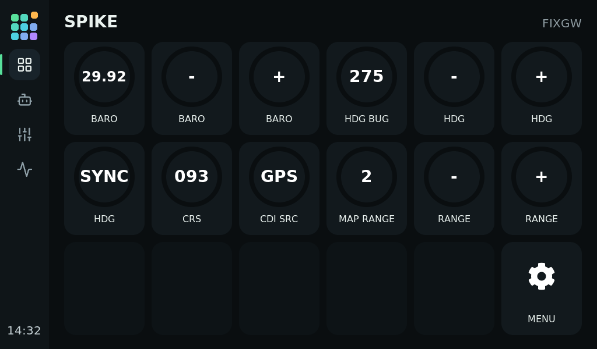

# Tessera Plugin (spike)

Drives a Tessera touch panel as a control head. The panel shows a page of keys
built from FIX values, and each press becomes the FIX writes the page file
names. This is the TESS1 spike (AER-5754). It ships off by default. TESS2
(AER-6622) ran it on a real panel on the Beelink bench; the results are under
"On a real panel" below.

Tessera is open "Stream Deck" firmware (MIT) for the GUITION JC1060P470C, an
ESP32-P4 board with a 7 in, 1024x600 capacitive touch screen. The plugin was
written against github.com/catorendal-a11y/tessera-deck at commit `5ab2486e`
(firmware 0.9.0, protocol 4). Its reference for every message is that commit's
`docs/PROTOCOL.md`, `main/main.cpp` and `main/deck_model.c`. Tessera's own
Windows host, editor and plugins are not used.

## Enable

In `preferences.yaml.custom`:

```yaml
enabled:
  TESSERA: true
```

Then set the port in `connections/tessera.yaml`:

| Option | Default | Meaning |
|---|---|---|
| `port` | `/dev/ttyACM0` | The panel's USB serial port. A udev symlink is steadier. |
| `page` | `tessera/page.yaml` | The page file, relative to the config directory. |
| `min_refresh` | `0.1` | Minimum seconds between page pushes. |
| `identify_interval` | `10.0` | Seconds between the `get_info` asks that catch a restart or a hang. |
| `reconnect_interval` | `2.0` | Seconds between attempts to open the port. |

## The page file

The panel has 18 keys, 6 across and 3 down. Id 1 is top left, and id 7 starts
the second row. The shipped page, `config/tessera/page.yaml`, shows baro,
heading bug, course and map range, with baro and heading keys. A press on
the HDG BUG key pulses `TSBTN132`, pyEfis's `heading-bug-focus` button, which
gives pyEfis's knob to the heading bug as a touch on its readout would
(pyEfis `focus` action, AER-6630). A press on the BARO key pulses `TSBTN136`,
pyEfis's `baro-focus` button, which does the same for the altimeter tape's baro
box (AER-6622):

```yaml
name: SPIKE
keys:
  - {id: 1, label: BARO, show: BARO, format: "{:.2f}", press: {pulse: TSBTN136}}
  - {id: 3, label: BARO, text: "+", press: {pulse: TSBTN12}}
  - {id: 10, label: MAP RANGE, show: MAPRANGE}
```

| Field | Meaning |
|---|---|
| `id` | 1 to 18, once each. |
| `label` | The text under the key, up to 24 characters. |
| `show` | A FIX key whose value is the key's centre text. |
| `format` | A Python format for `show`, default `{}`. The panel shows 7 characters at most. |
| `text` | Fixed centre text instead of `show`. |
| `press` | `{pulse: KEY}` writes True then False to a bool key. `{set: KEY, value: V}` writes V once. |
| `color` | The centre text colour as `#RRGGBB`. The panel decides whether a colour is valid. |
| `confirm` | `true`: the press is sent only after a 600 ms hold (the panel's `cf`). |

The plugin refuses to start if the page names a key the database lacks, or
pulses a key that is not a bool.

**A press writes only what its own key's `press` names.** A key with no
`press`, an unknown id, a long press, or a press that arrives before the
panel has accepted this session's page is answered with a red flash and writes
nothing. The last case matters because a panel that has just connected or
restarted shows the layout it saved, which may not be ours.

The `pulse` form is how a pyEfis touchscreen button or the Knobster's push
writes a button key. Pulsing `TSBTN12` runs the command of pyEfis's
`baro-up-invisible` button, as a tap on the glass would. pyEfis's stock data
bindings (`databindings/default.yaml`, pyEfis #591) run the baro, trim,
dimmer, heading-bug and CDI-source commands on any screen. A pyEfis whose
bindings file predates them acts only while that button shows
(`instruments/button` `dbkeyChanged`); for any other command that should work
on every screen, bind its key with a pyEfis data binding.

### How a key is drawn

Every key is a gauge tile with an empty ring: the centre text inside the ring
and the label underneath. The firmware changes a tile's label, colour and
gauge text in place, but any other change rebuilds the whole grid, and a
rebuild drops a press that is waiting for its feedback (`deck_model.c`
`same_structure`, `ui.cpp` `build_keys`). So a refresh changes only those
fields:

| Shown value | Centre text | Colour |
|---|---|---|
| good | the formatted value | the key's `color` (white) |
| old | the formatted value | amber `#FFB000` |
| bad or failed | `----` | red `#FF3030` |

These colours are placeholders for the spike, not a reviewed design.

The shipped page with sample values, as the panel firmware's own renderer
draws it (`images/tessera/README.md` has the commands):



## The link

| Step | What the plugin does |
|---|---|
| Open | Opens the port at 115200 and discards anything already waiting. |
| Handshake | Sends `{"cmd":"get_info"}` and waits 2.5 s for the `info` answer. It accepts only the GUITION board's two ids, `tessera-p4` and `tessera-p4-v3` (the build for a v3.x ESP32-P4 chip), with protocol 4, and anything else is refused and retried. Press events that arrive before the answer belong to an earlier session and are dropped unanswered. |
| Ping | `AD_PING` every second, including while a push waits for its answer. The panel shows NO PC after 3.5 s of silence. |
| Push | Sends the page as `AD_CFG_BEGIN`, `AD_CFG_DATA` in 380-character chunks, and `AD_CFG_END`, but only when a shown value changed, the page differs from what the panel last accepted, and the previous push has been answered. |
| Answer | `AD_CFG_END OK n`: accepted. With no answer in 4 s the page goes once more, and a second silence resets the link. `INVALID` and `TOO_BIG 8192` are answers about the page, so the plugin logs them and stops pushing until the next connection. A page over 8,192 bytes is never sent. |
| Press | `{"type":"deck_event","button":N}` makes the key's writes, then `AD_FEEDBACK ok N`, or `AD_FEEDBACK alert N` when nothing was written. |
| Restart | A new `bootId` is logged as a restart, as a warning when the `reset` reason is a crash or brownout. The page is pushed again, and presses wait until the panel accepts it. |
| Watch | `get_info` every `identify_interval` seconds. It catches a panel that restarted behind an open port, and two unanswered asks reset the link. |
| Unplug | A read or write error closes the port, and the plugin reopens it every `reconnect_interval` seconds. |

The panel writes its layout to flash only when the key structure changes, and
at most once in 10 minutes (`main.cpp` `layout_remember`,
`LAYOUT_SAVE_INTERVAL_US`). Live value pushes never touch flash.

## Status

`get_status()` reports the port, whether it is connected, the firmware
version, the boot id, and counters: connects, refused, pushes, acks, resends,
invalid, too big, presses, alerts, pings, restarts. The last error is
included too.

## What a full page costs

An 18-key page at the firmware's limits (24-character labels, 7-character
values) is a 1,678-byte layout. Framed, that is 7 lines and 1,767 bytes. Through
a real 8N1 UART at 115200 baud that takes 0.153 s, so a live value could refresh
at about 6 Hz. The test `test_full_page_size_and_wire_time` pins these numbers.

The panel's port is not a UART. The firmware reads it with
`usb_serial_jtag_read_bytes` (`main.cpp`), the ESP32-P4's native USB CDC
device, so the 115200 is a line setting that no hardware applies. The real cost
is USB transfer plus the panel's parse-and-redraw time. That makes 0.153 s an
upper bound for the transfer, but it says nothing about the redraw.

## On a real panel

TESS2 (AER-6622), 2026-11-25: a GUITION board with an ESP32-P4 v3.2 chip,
Tessera 1.2.12, the shipped 10-key page, on the Beelink with the Knobster
beside it. Commands and raw numbers are in
`doc/evidence/aer-6622-tessera-bench/`.

| Measure | Result |
|---|---|
| Refresh, shipped `min_refresh` 0.1 | 9.57 pages/s, every push answered `OK`, no resend |
| Refresh, `min_refresh` 0 | 29 pages/s, about 34 ms per push and answer |
| Press to FIX write (firmware `AD_PRESS`, same queue as a touch) | median 1.9 ms, max 41 ms, 20 of 20 |
| Press to pyEfis's write (HDG +, `HEADBUG`) | median 3.7 ms, max 41 ms, 10 of 10 |

An answer means the firmware accepted the page, not that the glass shows it.
The press numbers leave out the touch scan, the finger lift and the
firmware's USB loop wait of up to 20 ms.

## Tests

`tests/plugins/tessera/` runs the real plugin and real pyserial against a
scripted panel (`panel.py`) on a pty. The panel follows the firmware's rules
for line length, layout validation, in-place updates versus rebuilds, press
events and answers, and each rule cites the firmware function it mirrors. The
plugin opens a symlink, and the test swaps the pty behind it to unplug and
replug the panel.

## Not covered

- On the real panel, still not measured: press to glass, legibility, glove
  touch, and the USB behaviour of a panel restart or an unplug.
- Icons and images, firmware update, the panel's other screens, brightness,
  dimming and lock, and the configurator are out of scope.
- One page only. Page switching and knob focus are open questions (AER-5754).
